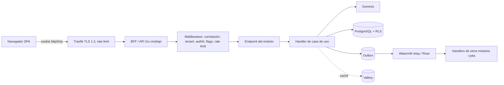

# Arquitectura de referencia — ERP para Agencias de Seguros (SaaS multi-tenant)

> Documento normativo. Las decisiones aquí descritas son **vinculantes** para humanos y agentes de IA. Cambiarlas exige un ADR (ver [docs/adr/README.md](../adr/README.md)).
> Contexto de negocio: [flujos.md](../../flujos.md). Modelo de dominio: [docs/domain/DOMAIN.md](../domain/DOMAIN.md).

---

## 0. Resumen ejecutivo

| Capa | Decisión | Por qué en una línea |
|---|---|---|
| Estilo | **Monolito modular** + **Arquitectura Hexagonal/Clean** por módulo, **DDD** | Un equipo, un VPS, dominio rico: máxima coherencia hoy, extracción a microservicios mañana sin reescribir. |
| Backend | **Go 1.26** (BSD) · `net/http` + chi · pgx + sqlc · contrato OpenAPI-first (oapi-codegen) | Binario estático de ~20 MB, ~30 MB de RAM por instancia, concurrencia nativa (goroutines), compilación estricta, cero licencias. |
| Mensajería / jobs | **Watermill** (MIT) con **outbox transaccional en PostgreSQL** + **River** (MPL-2.0, solo edición OSS) para jobs programados; RabbitMQ cuando haya >1 nodo | Consistencia eventual sin perder eventos; empieza sin broker extra. |
| Frontend | **React 19 + TypeScript (strict) + Vite**, TanStack Router/Query, Zustand, Tailwind + shadcn/ui, React Hook Form + Zod | SPA para back-office intensivo; ecosistema maduro y testeable. |
| Auth | **Keycloak** (OIDC/OAuth2.1, MFA) + patrón **BFF** (cookies httpOnly, sin tokens en el navegador) | Estándar, multi-tenant (Organizations), elimina robo de tokens por XSS. |
| BD transaccional | **PostgreSQL 17+**: esquema por módulo, `tenant_id` + **Row-Level Security**, JSONB para datos de riesgo por ramo | ACID para pólizas/cartera/comisiones; JSONB evita un NoSQL separado. |
| Caché | **Valkey** (fork OSS de Redis, BSD) vía `valkey-go` + caché L1 en memoria (`otter`, Apache-2.0) | Catálogos, flags, sesiones BFF, rate limiting. |
| Trabajos programados | River periodic jobs sobre PostgreSQL (renovaciones, recordatorios de cuota, mora) | Persistentes, reintentos, idempotentes, transaccionales con los datos. |
| Documentos | Almacenamiento **S3-compatible**: **SeaweedFS** (Apache-2.0) en VPS o Cloudflare R2; cifrado SSE + URLs prefirmadas | Pólizas, soportes de siniestros, SARLAFT. (MinIO descartado: AGPL y sin binarios comunitarios desde 2025.) |
| Feature flags | **OpenFeature** (SDK estándar) + proveedor propio en PostgreSQL + caché Valkey, evaluado por tenant/plan/rol | Encender/apagar módulos y funcionalidades de forma independiente por tenant. |
| Observabilidad | **OpenTelemetry** → Grafana LGTM (Loki, Grafana, Tempo, Mimir/Prometheus) | Trazas, métricas y logs correlacionados, vendor-neutral. |
| DevOps | Docker Engine (Apache-2.0) multi-stage, imagen `distroless/static` non-root, **Docker Compose** + **Traefik** en VPS; ruta a **k3s**. En estaciones de desarrollo: **Docker Desktop** (permitido: la empresa está bajo el umbral de licencia, ver §9) + **Dev Container** con todas las herramientas | Simple hoy, Kubernetes-compatible mañana. CI/CD con GitHub Actions + GHCR. |

---

## 1. Arquitectura general

### 1.1 Monolito modular (no microservicios… todavía)

Con ~500 usuarios concurrentes, picos de 10.000 y un VPS de Hostinger, los microservicios añadirían latencia de red, transacciones distribuidas, N pipelines y N bases de datos sin beneficio real. El **monolito modular** da:

- **Un solo despliegue**, una sola transacción ACID cuando hace falta (ej. expedir póliza + generar cuotas en el mismo módulo).
- **Fronteras duras entre módulos** verificadas por pruebas de arquitectura (no por disciplina).
- **Extracción futura**: cada módulo ya se comunica por contratos e eventos de integración; mover uno a su propio proceso = cambiar el publisher/subscriber de Watermill de PostgreSQL a RabbitMQ.

### 1.2 Módulos (Bounded Contexts) derivados de los flujos de negocio

| Módulo | Flujo(s) | Responsabilidad | Apagable |
|---|---|---|---|
| `Platform.Tenancy` | — | Tenants, planes, suscripción | ❌ núcleo |
| `Platform.Identity` | — | Usuarios, roles, permisos (sincronizado con Keycloak) | ❌ núcleo |
| `Platform.FeatureManagement` | — | Flags y entitlements por tenant | ❌ núcleo |
| `Platform.Audit` | 10 | Bitácora inmutable de acciones | ❌ núcleo |
| `Parties` | todos | Clientes (tomador, asegurado, beneficiario), contactos, consentimiento de datos | ❌ núcleo |
| `Catalog` | 2,3,9 | Aseguradoras, ramos, productos, tablas de comisión pactada | ❌ núcleo |
| `Policies` | 3,5,8 | Póliza, coberturas, bienes asegurados, endosos, cancelación, máquina de estados | ❌ núcleo |
| `Crm` | 1 | Prospectos, embudo, asignación de asesor, seguimientos | ✅ |
| `Quoting` | 2 | Solicitudes de cotización, propuestas, comparativo | ✅ |
| `Renewals` | 6 | Alertas, recotización, retención | ✅ |
| `Billing` | 4 | Planes de pago, cuotas, registro de pagos informados (el cliente paga directo a la aseguradora), cartera, gestión de cobro | ✅ |
| `Claims` | 7 | Siniestros, documentación, seguimiento con aseguradora | ✅ |
| `Commissions` | 9 | Comisión esperada, liquidación de aseguradora, conciliación, comisión interna | ✅ |
| `Compliance` | 10 | SARLAFT, listas restrictivas, PQR, habeas data | ✅ (recomendado siempre on en Colombia) |
| `Documents` | todos | Gestión documental, versiones, retención | ✅ |
| `Notifications` | 4,6,7 | Email/SMS/WhatsApp, plantillas | ✅ |
| `Reporting` | KPIs | Indicadores (§7 de flujos), proyecciones de lectura | ✅ |
| `Integrations.Insurers` | 2,3,9 | Adaptadores a portales/APIs de aseguradoras (anti-corruption layer) | ✅ por aseguradora |

**Regla de dependencias entre módulos:** un módulo apagable **nunca** es requerido por un módulo núcleo. Los módulos apagables reaccionan a **eventos** de los núcleo (ej. `PolicyIssued` → `Billing` genera cuotas, `Commissions` calcula comisión esperada). Si `Billing` está apagado, la póliza se expide igual.

### 1.3 Capas dentro de cada módulo (Hexagonal / Clean)

```
internal/modules/<modulo>/
  domain/        → Entidades, Value Objects, Agregados, domain events, errores de dominio. Solo stdlib + platform/kernel.
  app/           → Casos de uso (commands/queries + handlers), puertos (interfaces), validación, autorización.
  adapters/
    postgres/    → Repositorios con pgx + sqlc (queries .sql propias, esquema propio).
    http/        → Handlers generados por oapi-codegen (strict server), mapeo DTO, gating por feature flag.
    <externo>/   → Clientes HTTP de aseguradoras, almacenamiento, etc.
  contracts/     → ÚNICA superficie pública: integration events + DTOs + interfaces de consulta.
  module.go      → Wiring explícito del módulo (constructor que recibe dependencias).
```

Dependencias permitidas: `adapters/http → app → domain`; `adapters/postgres → app, domain`; otros módulos → **solo** `<modulo>/contracts`. Verificado en CI con **go-arch-lint** y `depguard` (golangci-lint).

### 1.4 Flujo de una petición



---

## 2. Frontend

| Aspecto | Tecnología | Justificación |
|---|---|---|
| Framework | React 19 + TypeScript `strict` + Vite | Back-office intensivo en formularios y tablas: SPA es más simple que SSR; no hay SEO. |
| Routing | TanStack Router (type-safe, file-based, code-splitting por módulo) | Rutas tipadas; cada módulo es un chunk lazy → si el flag está apagado ni siquiera se descarga. |
| Estado servidor | TanStack Query | Caché, reintentos, invalidación; elimina estado global duplicado. |
| Estado cliente | Zustand (mínimo: UI, preferencias) | Liviano; no Redux. |
| Formularios | React Hook Form + Zod (esquemas compartidos generados desde OpenAPI) | Formularios de pólizas/siniestros grandes con validación consistente. |
| Estilos / UI | Tailwind CSS v4 + shadcn/ui (Radix) + TanStack Table | Accesibilidad (WCAG 2.2 AA), componentes propios, tablas virtualizadas para cartera. |
| Cliente API | Generado desde OpenAPI (orval) | Contrato único; cero DTOs escritos a mano. |
| Flags en UI | OpenFeature Web SDK alimentado por `/bff/features` | Oculta menú/rutas; **el backend sigue siendo la autoridad**. |
| i18n | i18next (es-CO por defecto) | Formatos COP, fechas `dd/MM/yyyy`. |
| Pruebas | Vitest + Testing Library + MSW; Playwright E2E | |

**Seguridad en cliente:** sin tokens en `localStorage`/JS (patrón BFF, cookies `HttpOnly; Secure; SameSite=Strict`); CSP estricta con nonces, sin `unsafe-inline`/`unsafe-eval`; Trusted Types; prohibido `dangerouslySetInnerHTML` salvo DOMPurify; protección CSRF (SameSite + header anti-forgery); SRI; ningún dato sensible en URLs ni en logs del navegador; enmascarar documentos de identidad en UI por defecto.

---

## 3. Backend

**Go 1.26 (licencia BSD-3).** Todas las librerías elegidas son MIT, BSD, Apache-2.0 o MPL-2.0, sin ediciones de pago.

Por qué Go frente a Python para este caso:
- **Rendimiento y memoria en VPS:** un proceso Go atiende miles de conexiones concurrentes con decenas de MB; Python (FastAPI/Django) necesitaría varios workers y 5–10× más RAM para la misma carga de picos.
- **Corrección:** tipado estático compilado, sin excepciones ocultas (errores explícitos), `go vet` + golangci-lint estrictos. Python exige disciplina extra (mypy strict) para lograr garantías similares.
- **Operación:** un solo binario estático por proceso (`api`, `worker`, `migrate`), imágenes de ~20 MB, arranque en milisegundos.
- **Dinero:** Go no tiene decimal nativo → se usa **`shopspring/decimal`** encapsulado en el value object `Money` (redondeo bancario `RoundBank`). Prohibido `float64` para montos.
- Python queda como opción válida solo para tareas analíticas/reportes fuera del camino crítico (decisión vía ADR).

| Necesidad | Librería (licencia) |
|---|---|
| HTTP / router | `net/http` + `go-chi/chi` v5 (MIT) |
| Contrato API | OpenAPI 3.1 *spec-first* en `api/openapi/` → `oapi-codegen` strict server (Apache-2.0); mismo spec genera el cliente TS (orval) |
| Persistencia | `jackc/pgx` v5 (MIT) + `sqlc` (MIT) — SQL escrito a mano, código tipado generado; sin ORM |
| Migraciones | `pressly/goose` (MIT), carpeta por módulo |
| Dinero | `shopspring/decimal` (MIT) dentro de `kernel.Money` |
| Validación | `go-playground/validator` v10 (MIT) + validación de dominio en constructores |
| Errores | Errores de dominio tipados con código estable; `ProblemDetails` (RFC 9457) en HTTP |
| Eventos / outbox | `ThreeDotsLabs/watermill` (MIT) + `watermill-sql` (PostgreSQL); `watermill-amqp` en fase 2 |
| Jobs programados | `riverqueue/river` (MPL-2.0) — **solo edición OSS, no River Pro** |
| Auth OIDC / sesiones BFF | `coreos/go-oidc` (Apache-2.0), `golang.org/x/oauth2` (BSD), `alexedwards/scs` (MIT) con store Valkey |
| Resiliencia | `sony/gobreaker` (MIT) + `hashicorp/go-retryablehttp` (MPL-2.0); timeouts con `context` |
| Feature flags | OpenFeature Go SDK (Apache-2.0) + proveedor propio `tenantflags` |
| Caché | `valkey-io/valkey-go` (Apache-2.0), `maypok86/otter` (Apache-2.0) |
| Rate limiting | `go-chi/httprate` (MIT) con backend Valkey |
| Observabilidad | OpenTelemetry Go (Apache-2.0), `log/slog` (stdlib) |
| Cripto | stdlib `crypto/aes`, `crypto/cipher` (GCM), `crypto/hmac` |
| Pruebas | `testing` (stdlib), `stretchr/testify` (MIT), `testcontainers-go` (MIT), `go.uber.org/mock` (Apache-2.0), `brianvoe/gofakeit` (MIT), go-arch-lint (MIT); k6 (AGPL, solo herramienta) para carga |
| Lint / seguridad | golangci-lint (GPL-3, solo herramienta), `gosec`, `govulncheck` (BSD) |

---

## 4. Base de datos

### 4.1 PostgreSQL como única fuente de verdad
- **Relacional** para todo lo que tiene dinero, estados o regulación: pólizas, cuotas, pagos, comisiones, siniestros. Requiere ACID, constraints e integridad referencial.
- **JSONB** para el *dato de riesgo variable por ramo* (autos: placa/modelo; vida: ocupación/salud; hogar: inmueble). Validado por esquema JSON versionado en `Catalog`. Esto cubre el caso “documental” **sin** añadir MongoDB (otra tecnología que operar, respaldar y asegurar).
- **No se usa NoSQL** en la fase inicial. Reconsiderar solo con ADR (ej. búsqueda full-text masiva → OpenSearch).

### 4.2 Multi-tenancy
- Modelo **pool**: tablas compartidas con `tenant_id uuid NOT NULL` en toda tabla de negocio.
- **Row-Level Security** obligatoria: `USING (tenant_id = current_setting('app.tenant_id')::uuid)`; la app conecta con rol sin `BYPASSRLS`. El helper `platform/db.WithTenantTx(ctx, fn)` abre la transacción y ejecuta `SELECT set_config('app.tenant_id', $1, true)` antes de cualquier query; es la **única** forma permitida de obtener una conexión. Defensa en profundidad además de incluir `tenant_id` en los `WHERE` de sqlc.
- Tenants enterprise pueden migrarse a modelo **silo** (BD propia) sin cambiar código (resolución de connection string por tenant).

### 4.3 Esquemas y migraciones
- Un esquema PostgreSQL por módulo (`policies`, `billing`, …). Prohibido JOIN entre esquemas desde código de módulo; `Reporting` lee de vistas materializadas/réplica.
- Migraciones SQL con goose en `migrations/<modulo>/`, aplicadas por el binario `cmd/migrate` como job de despliegue (nunca al arrancar la app en prod). Patrón **expand/contract** para cero downtime.

### 4.4 Cifrado y datos sensibles
- En tránsito: TLS 1.3 en todo (incluida la conexión app↔BD si están en hosts distintos).
- En reposo: disco cifrado (LUKS) en VPS + backups cifrados (pgBackRest, AES-256) fuera del proveedor.
- **Cifrado a nivel de campo** (AES-256-GCM, envelope encryption, llaves en OpenBao o KMS externo) para: número de documento, datos de salud, cuentas bancarias, información SARLAFT. Para búsquedas: columna *blind index* (HMAC-SHA256).
- Auditoría: tabla `audit.events` append-only (sin UPDATE/DELETE para el rol de app).

### 4.5 Rendimiento
- PgBouncer (transaction pooling). Índices compuestos que empiezan por `tenant_id`. Particionado por rango de fecha en `audit.events`, `billing.payments`, `notifications`. Réplica de lectura para `Reporting` cuando la carga lo justifique.

---

## 5. Caché y trabajo asíncrono

| Uso | Mecanismo | TTL / política |
|---|---|---|
| Catálogos (aseguradoras, ramos, productos) | L1 otter + L2 Valkey, clave `t:{tenant}:catalog:*` | 1 h + invalidación por evento |
| Feature flags evaluados | L1 30 s + Valkey pub/sub para invalidación inmediata | |
| Sesiones BFF | Valkey | Sliding 30 min, absoluto 8 h |
| Rate limiting distribuido | Valkey | Por tenant, usuario e IP |
| Idempotency keys (pagos, comandos POST) | Valkey + tabla PG | 24 h |

**Prohibido cachear** datos personales sensibles sin cifrar ni respuestas que dependan de permisos sin incluir el rol/usuario en la clave.

**Asíncrono:** Watermill con **outbox transaccional en PostgreSQL** (el evento se inserta en la misma transacción pgx que el cambio; un relay lo publica) + tabla `inbox` por consumidor para idempotencia. Garantía at-least-once. River ejecuta los jobs programados y también se encola dentro de la misma transacción (`InsertTx`).
- Eventos de integración entre módulos (`PolicyIssued`, `InstallmentOverdue`, `PolicyCancelled`, `ClaimReported`…).
- Jobs programados: alertas de renovación (30/60 días), recordatorios de cuota, marcación de mora, conciliación de comisiones, generación de reportes pesados, envío de notificaciones.
- **Fase 2** (multi-nodo o extracción de módulos): transporte RabbitMQ (quorum queues) con el mismo código de handlers.

---

## 6. Contenedores y DevOps

### 6.1 Imágenes
- Dockerfile multi-stage; build con `golang:1.26` (`CGO_ENABLED=0`, `-trimpath`, `-ldflags="-s -w"`); runtime `gcr.io/distroless/static-debian12:nonroot` (sin shell, non-root); frontend servido como estáticos embebidos en el binario (`embed`) o por nginx-unprivileged.
- Imágenes fijadas por **digest**, escaneadas con Trivy, SBOM (Syft) y firmadas (Cosign). `HEALTHCHECK` vía endpoints `/health/live` y `/health/ready`.
- Filesystem de solo lectura, `no-new-privileges`, capabilities eliminadas, límites de CPU/RAM.

### 6.2 Topología inicial (VPS Hostinger, recomendado KVM 8: 8 vCPU / 32 GB)

```
Traefik (TLS Let's Encrypt, HSTS, WAF ligero/CrowdSec, rate limit)
 ├─ api (Go, API+BFF)  x2 réplicas   ← stateless
 ├─ worker (Go: relay outbox, consumidores, River)
 ├─ keycloak
 ├─ postgres 17 + pgbouncer
 ├─ valkey
 ├─ seaweedfs S3 (o R2 externo)
 └─ otel-collector → grafana stack (o Grafana Cloud free tier para no consumir el VPS)
```

Redes Docker separadas (`edge`, `app`, `data`); solo Traefik expone puertos (443). SSH con llave + firewall (UFW) + fail2ban. Backups: pgBackRest a almacenamiento externo (R2/B2) con prueba de restauración mensual.

> **Realismo de capacidad:** 500 concurrentes caben holgadamente en un KVM 8. Picos de 10.000 concurrentes exigen: (a) PostgreSQL en VPS dedicado, (b) ≥2 VPS de app detrás de balanceador, (c) CDN para estáticos. La arquitectura stateless lo permite sin cambios de código; validar con pruebas k6 antes de comprometer SLAs.

### 6.3 Evolución
1. **Fase 1:** 1 VPS, Docker Compose.
2. **Fase 2:** 3+ VPS, **k3s** (Kubernetes ligero), BD dedicada, RabbitMQ, réplica de lectura.
3. **Fase 3:** extracción de módulos calientes (ej. `Notifications`, `Integrations.Insurers`) a servicios propios si métricas lo justifican.

### 6.4 CI/CD (GitHub Actions)
`lint (golangci-lint, eslint) → build → unit (`go test -race`) → architecture (go-arch-lint) → integration (testcontainers-go) → SAST (gosec + Semgrep CE) → SCA (govulncheck, Dependabot, pnpm audit) → licencias (go-licenses, license-checker) → secret scan (gitleaks) → build image → Trivy → SBOM + firma → deploy staging → E2E Playwright + ZAP baseline → aprobación manual → deploy prod (rolling) → smoke tests`.

---

## 7. Feature Flags — diseño (requisito central)

Dos tipos, un solo motor:

| Tipo | Ejemplo de clave | Quién lo cambia | Vida |
|---|---|---|---|
| **Entitlement de módulo** | `module.claims` | Super-admin/plan comercial | Permanente |
| **Funcionalidad** | `claims.whatsapp-intake` | Admin del tenant (si el plan lo permite) | Permanente |
| **Release toggle** | `release.billing.new-reconciliation` | Ingeniería | Temporal, con fecha de retiro |
| **Kill switch / ops** | `ops.integrations.sura.enabled` | Operaciones | Permanente |

**Evaluación:** contexto = `{tenantId, plan, userId, roles}`. Prioridad: kill switch global → override por tenant → plan → default del registro. **Fail-closed** (si el proveedor falla, se usa el último valor en caché; si no hay, `false` para funcionalidades no-núcleo).

**Aplicación en todas las capas:**
1. Endpoint: middleware chi `flags.Require(flags.ClaimsModule)` en el grupo de rutas → 404 si apagado (no revela existencia).
2. Handlers de eventos y jobs: verifican el flag del tenant antes de actuar.
3. UI: rutas/menús condicionados; chunks lazy no se descargan.
4. Datos: apagar un módulo **nunca borra datos**; se vuelven inaccesibles hasta re-encenderlo.
5. Dependencias declaradas en el manifiesto del módulo (`requires: ["module.policies"]`); el sistema impide encender un módulo cuyas dependencias estén apagadas.

Detalle operativo: [.claude/rules/feature-flags.md](../../.claude/rules/feature-flags.md).

---

## 8. Seguridad (mapa OWASP Top 10:2025)

| Riesgo | Control |
|---|---|
| A01 Broken Access Control | Autorización por política en cada endpoint (deny-by-default), RLS por tenant, verificación de propiedad del recurso, pruebas de IDOR automatizadas. |
| A02 Security Misconfiguration | Headers de seguridad, CSP, imágenes distroless, config por entorno, UI de documentación OpenAPI y `pprof` deshabilitados en prod. |
| A03 Software Supply Chain Failures | Lockfiles, Dependabot, SBOM, firma de imágenes, pin por digest, solo registries aprobados. |
| A04 Cryptographic Failures | TLS 1.3, AES-256-GCM (stdlib Go) a nivel de campo con envelope encryption y llaves en OpenBao, sin algoritmos propios. |
| A05 Injection | Solo queries sqlc/pgx parametrizadas; prohibido SQL concatenado (`fmt.Sprintf` en SQL); validación con validator/Zod; `html/template` con auto-escape. |
| A06 Insecure Design | Threat modeling (STRIDE) por módulo nuevo; límites de negocio (montos, frecuencia). |
| A07 Authentication Failures | Keycloak: MFA obligatoria para roles financieros/admin, bloqueo por intentos, política de contraseñas NIST 800-63B. |
| A08 Software/Data Integrity Failures | Firma de artefactos, idempotencia, auditoría append-only, webhooks con HMAC. |
| A09 Logging & Alerting Failures | Logs estructurados sin PII, auditoría de eventos de seguridad, alertas en Grafana. |
| A10 Mishandling of Exceptional Conditions | Middleware de recover + mapeo de errores → problem+json (RFC 9457) sin detalles internos; fail-closed en authz y flags. |

---

## 9. Política de licencias

Detalle y justificación: [ADR 0011](../adr/0011-politica-de-licencias-sin-pago-por-uso.md). **Principio: ningún software por el que haya que pagar por uso, usuario, instancia o umbral, y ninguna licencia que obligue a publicar el código propio.**

- **Permitidas en cualquier capa:** licencias permisivas y de dominio público (MIT, MIT-0, BSD, 0BSD, ISC, Apache-2.0, PostgreSQL, Zlib, BlueOak-1.0.0, Unlicense, CC0-1.0, Python-2.0; CC-BY-4.0 solo para datos) y MPL-2.0 sin modificar sus archivos.
- **Solo como herramienta o servicio sin modificar:** GPL/LGPL/AGPL (Grafana, Loki, k6, golangci-lint); nunca enlazadas en el binario ni empaquetadas en el frontend.
- **Prohibidas:** ediciones "Pro/Enterprise" de pago (River Pro, Watermill Pro), licencias BSL/SSPL/Elastic/Commons Clause (HashiCorp Vault ≥1.15, Redis ≥7.4), GitHub Advanced Security/CodeQL en repos privados (usar Semgrep CE + gosec).
- **Docker Desktop** solo en estaciones de desarrollo mientras la empresa tenga <250 empleados y <USD 10M de ingresos anuales (si se supera: suscripción o Rancher Desktop, mismos comandos); servidores con Docker Engine.
- Costos de infraestructura (VPS, backups externos, SMS/WhatsApp) no son licencias; se prefieren alternativas autoalojadas y proveedores detrás de un puerto.

Verificación automática en CI con `go-licenses` (`make licenses`) y `license-checker` (`pnpm licenses`).

---

Cumplimiento Colombia (validar con asesor legal): Ley 1581/2012 (habeas data) y Decreto 1377/2013; SARLAFT (Circular Básica Jurídica SFC); retención documental.
