# Flujos operativos de una agencia de seguros

> Documento introductorio para entender y documentar cómo funciona una agencia (intermediario) de venta de seguros. Describe un modelo **estándar y genérico**; cada agencia real tiene variaciones que deben validarse con el negocio (ver sección final).

---

## 1. Lo primero: qué es (y qué no es) una agencia de seguros

Una **agencia de seguros** es un **intermediario**: vende y administra seguros, pero **no asume el riesgo**. El riesgo lo asume la **aseguradora** (la compañía de seguros), que es quien paga cuando ocurre un siniestro.

La agencia:

- Consigue clientes y los asesora.
- Cotiza con una o varias aseguradoras.
- Tramita la expedición de la póliza.
- Acompaña al cliente durante la vigencia (cambios, cobros, renovaciones, reclamos).
- **Gana una comisión**: un porcentaje de la prima que paga el cliente, que le liquida la aseguradora.

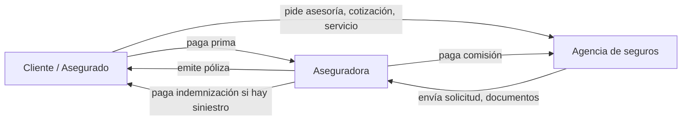

> Nota: en algunos esquemas la agencia **recauda** la prima y luego la transfiere a la aseguradora; en otros el cliente paga directo a la aseguradora. Esto cambia bastante la operación (ver Flujo 4).

### Tipos de intermediario (de forma general)

| Tipo | Descripción típica |
|---|---|
| **Agente / Agencia** | Representa a una o varias aseguradoras con las que tiene contrato. |
| **Corredor (broker)** | Representa al cliente; compara el mercado y negocia con muchas aseguradoras. Suele manejar clientes corporativos grandes. |
| **Agente independiente** | Persona natural que vende seguros, a veces vinculada a una agencia. |

En Colombia estos intermediarios están regulados y vigilados (principalmente por la Superintendencia Financiera). Los requisitos exactos deben consultarse con la agencia y la normativa vigente.

---

## 2. Glosario mínimo

| Término | Significado |
|---|---|
| **Póliza** | El contrato de seguro. Tiene número, vigencia, coberturas, condiciones. |
| **Ramo** | Tipo de seguro: autos, vida, salud, hogar, SOAT, responsabilidad civil, cumplimiento, etc. |
| **Tomador** | Quien contrata y paga el seguro. |
| **Asegurado** | La persona o bien protegido. |
| **Beneficiario** | Quien recibe la indemnización (ej. en seguro de vida). |
| **Prima** | El precio del seguro. |
| **Suma asegurada** | Valor máximo que pagaría la aseguradora. |
| **Cobertura / amparo** | Qué riesgos cubre la póliza. |
| **Exclusión** | Lo que expresamente **no** cubre. |
| **Deducible** | Parte de la pérdida que asume el asegurado. |
| **Vigencia** | Periodo en que la póliza está activa (usualmente 1 año). |
| **Cotización** | Propuesta de precio y condiciones antes de contratar. |
| **Suscripción** | Evaluación del riesgo por la aseguradora para aceptarlo o no. |
| **Expedición / emisión** | Creación formal de la póliza. |
| **Endoso** | Modificación a una póliza vigente (cambio de placa, aumento de valor, inclusión de un asegurado). |
| **Renovación** | Nueva vigencia de una póliza que vence. |
| **Revocación / cancelación** | Terminación anticipada de la póliza. |
| **Siniestro** | El evento que activa el seguro (choque, robo, incendio, fallecimiento). |
| **Reclamación** | Trámite para que la aseguradora pague el siniestro. |
| **Indemnización** | Lo que paga la aseguradora por el siniestro. |
| **Comisión** | Porcentaje de la prima que gana la agencia. |
| **Cartera** | Primas pendientes de pago por los clientes. |

---

## 3. Vista general: el ciclo de vida de un cliente y su póliza

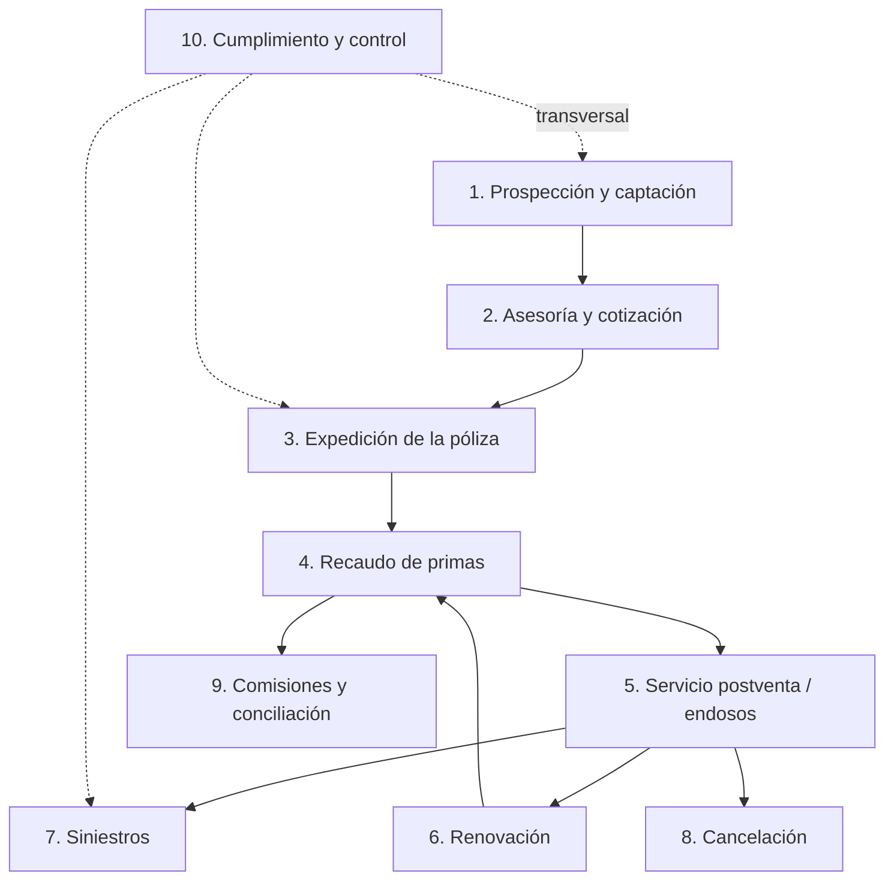

Los flujos 1–3 son la **venta**; 4–8 la **administración durante la vida de la póliza**; 9 es el **negocio de la agencia**; 10 es **transversal**.

---

## 4. Flujos operativos

### Flujo 1 — Prospección y captación de clientes

**Objetivo:** conseguir personas o empresas interesadas en asegurarse.

**Fuentes de prospectos (leads):** referidos, redes sociales, sitio web, alianzas (concesionarios, inmobiliarias, bancos), cartera existente (venta cruzada), llamadas, eventos.

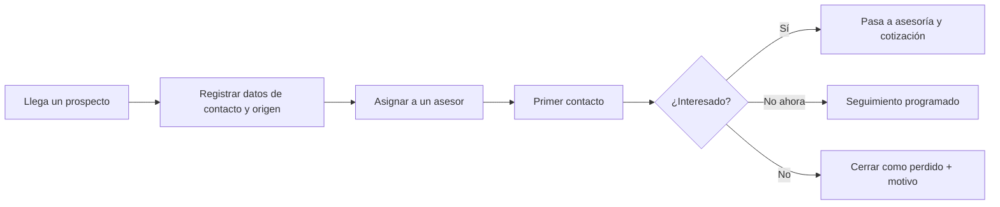

**Qué se registra:** nombre, contacto, origen del lead, ramo de interés, asesor asignado, estado, fechas de contacto.

---

### Flujo 2 — Asesoría y cotización

**Objetivo:** entender la necesidad del cliente y presentarle opciones de seguro.

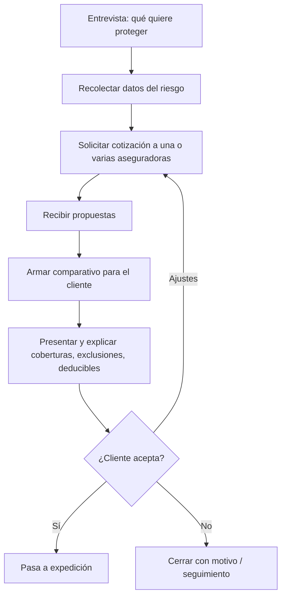

**Datos típicos del riesgo según ramo:**

- **Autos:** placa, marca, modelo, año, uso, ciudad de circulación, conductor.
- **Vida:** edad, ocupación, estado de salud (declaración), suma deseada, beneficiarios.
- **Hogar:** dirección, tipo de inmueble, valor de la construcción y contenidos.
- **Empresas:** actividad, activos, número de empleados, siniestralidad previa.

**Cómo se cotiza:** muchas aseguradoras tienen portales o tarificadores en línea; en riesgos complejos se envía la solicitud por correo y un suscriptor de la aseguradora responde.

**Qué se registra:** cotización (número, aseguradora, ramo, prima, coberturas, vigencia de la oferta), comparativo enviado, decisión del cliente.

---

### Flujo 3 — Expedición (emisión) de la póliza

**Objetivo:** formalizar el contrato.

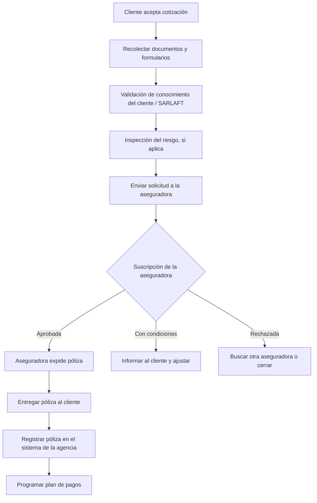

**Documentos frecuentes:** documento de identidad o certificado de existencia (empresas), formulario de solicitud, formulario de conocimiento del cliente, tarjeta de propiedad (autos), declaración de salud (vida), fotos o inspección.

**Inspección:** común en autos usados o inmuebles; la hace la aseguradora o un tercero.

**Qué se registra:** número de póliza, aseguradora, ramo, tomador, asegurado(s), beneficiarios, bienes asegurados, coberturas, suma asegurada, prima, vigencia (desde/hasta), forma de pago, asesor, comisión pactada.

---

### Flujo 4 — Recaudo de primas

**Objetivo:** que el cliente pague y la póliza no se caiga por mora.

Existen dos modelos principales:

| Modelo | Cómo funciona | Implicación para la agencia |
|---|---|---|
| **Pago directo a la aseguradora** | El cliente paga en el portal o cuenta de la aseguradora. | La agencia solo hace seguimiento y recordatorios. |
| **Recaudo por la agencia** | El cliente paga a la agencia, que luego transfiere a la aseguradora. | La agencia maneja dinero de terceros: requiere control contable estricto. |

**Formas de pago:** contado, cuotas (mensual, trimestral), débito automático, **financiación de primas** (una financiera paga la prima completa y el cliente le paga cuotas).

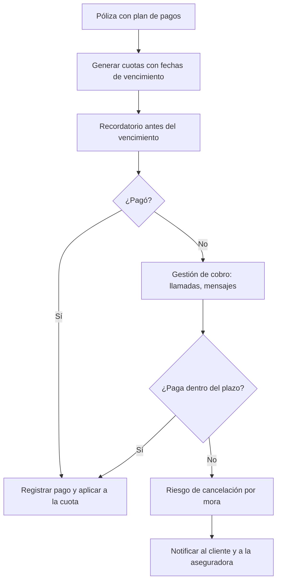

**Qué se registra:** cuotas, fechas, valores, pagos, medio de pago, saldo en cartera, gestiones de cobro.

---

### Flujo 5 — Servicio postventa y endosos

**Objetivo:** atender cambios y solicitudes del cliente durante la vigencia.

**Solicitudes típicas:**

- Cambio de datos (dirección, teléfono).
- Cambio de vehículo o de placa.
- Inclusión o exclusión de asegurados o beneficiarios.
- Aumento o disminución de suma asegurada.
- Certificados (ej. constancia de póliza vigente para un banco o una licitación).
- Duplicados de documentos.

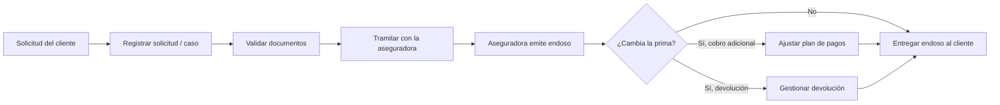

**Qué se registra:** caso o solicitud, tipo, fechas, responsable, endoso resultante, efecto en prima.

---

### Flujo 6 — Renovaciones

**Objetivo:** conservar al cliente cuando la póliza vence. **Es uno de los flujos más importantes**: una agencia vive en gran parte de renovar su cartera.

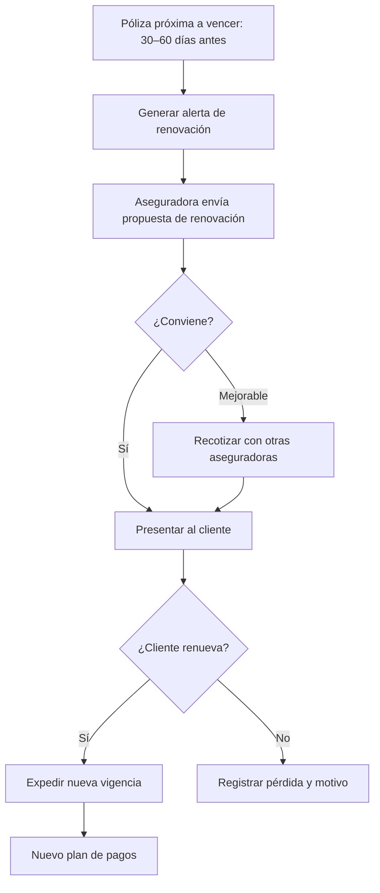

Algunas pólizas se renuevan **automáticamente**; aun así la agencia suele revisarlas por si cambió el precio.

**Indicador clave:** tasa de retención (pólizas renovadas / pólizas por vencer).

---

### Flujo 7 — Siniestros (reclamaciones)

**Objetivo:** acompañar al cliente cuando ocurre el evento asegurado. Es el momento en que el cliente evalúa de verdad el servicio de la agencia.

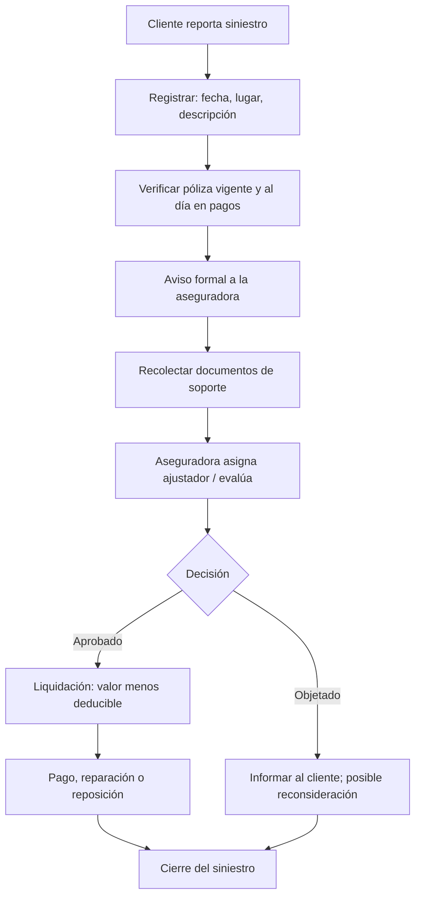

**Documentos típicos:** denuncia (en robo), informe de tránsito o croquis (autos), facturas, fotos, historia clínica (salud), certificado de defunción (vida).

**Rol de la agencia:** orientar, reunir documentos, hacer seguimiento con la aseguradora, defender al cliente si hay objeción. **No decide** si se paga: lo decide la aseguradora.

**Qué se registra:** número de siniestro, póliza, fecha de ocurrencia y aviso, tipo, estado, valor reclamado, valor pagado, documentos, gestiones.

---

### Flujo 8 — Cancelación o revocación

**Causas:** el cliente vende el bien, decide no continuar, mora en el pago, o la aseguradora revoca.

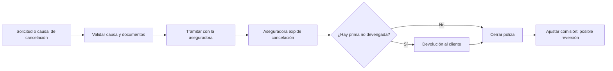

**Ojo:** si se cancela una póliza, la aseguradora puede **descontar la comisión** ya pagada a la agencia por la parte no devengada.

---

### Flujo 9 — Comisiones y conciliación con aseguradoras

**Objetivo:** asegurarse de que la agencia cobre lo que le corresponde. Es el flujo financiero central del negocio.

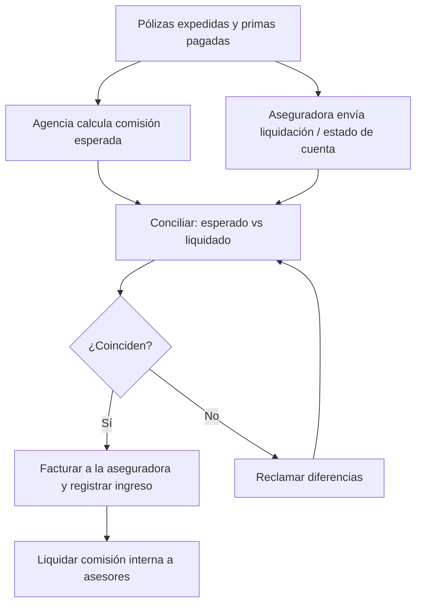

**Puntos clave:**

- La comisión suele depender del **ramo** y de la **aseguradora**, y a veces de metas (incentivos o sobrecomisiones).
- Normalmente se causa sobre **prima efectivamente pagada**, no solo emitida.
- Los asesores internos reciben a su vez una parte (comisión interna).

**Qué se registra:** porcentaje de comisión por póliza, comisión esperada, comisión liquidada, diferencias, facturas, pagos recibidos, comisiones a asesores.

---

### Flujo 10 — Cumplimiento y control (transversal)

Aplica a casi todos los flujos anteriores:

- **Conocimiento del cliente / prevención de lavado de activos** (en Colombia, SARLAFT): formularios, verificación en listas restrictivas, reporte de operaciones inusuales.
- **Protección de datos personales**: autorización de tratamiento de datos y manejo seguro de información, en especial la de salud.
- **Atención de quejas** del consumidor financiero.
- **Gestión documental**: conservar pólizas, soportes y comunicaciones.
- **Acreditación de asesores**: los intermediarios suelen requerir formación o certificación para vender.

---

## 5. Roles típicos dentro de la agencia

| Rol | Responsabilidades |
|---|---|
| **Gerente / director** | Relación con aseguradoras, metas, negociación de comisiones. |
| **Asesor comercial** | Prospección, asesoría, cotización, cierre de ventas. |
| **Auxiliar técnico / operativo** | Expedición, endosos, renovaciones, documentos. |
| **Analista de siniestros** | Acompañamiento de reclamaciones. |
| **Cartera y recaudo** | Cobro de primas, conciliación de pagos. |
| **Contabilidad** | Comisiones, facturación, conciliaciones. |
| **Oficial de cumplimiento** | SARLAFT, quejas, controles regulatorios. |

En agencias pequeñas una misma persona cubre varios roles.

---

## 6. Entidades de información principales

Útil si se va a construir o evaluar un sistema para la agencia.

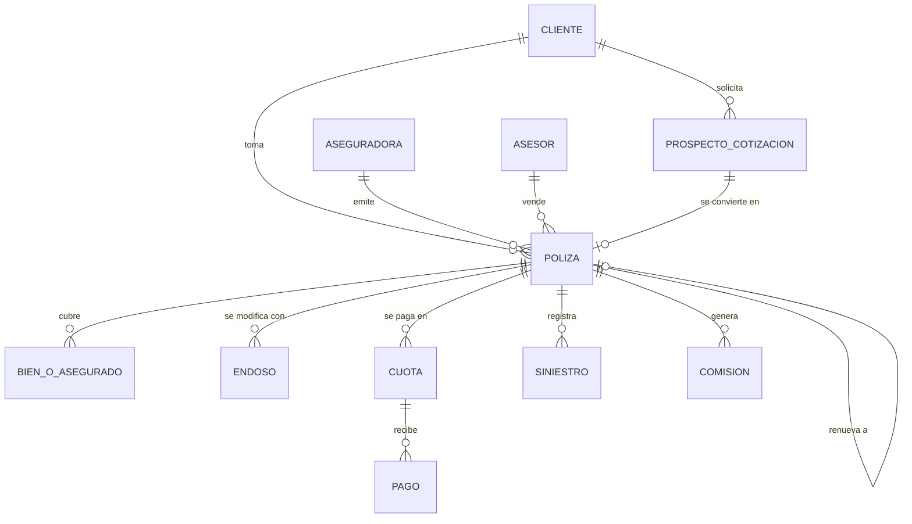

### Estados típicos de una póliza

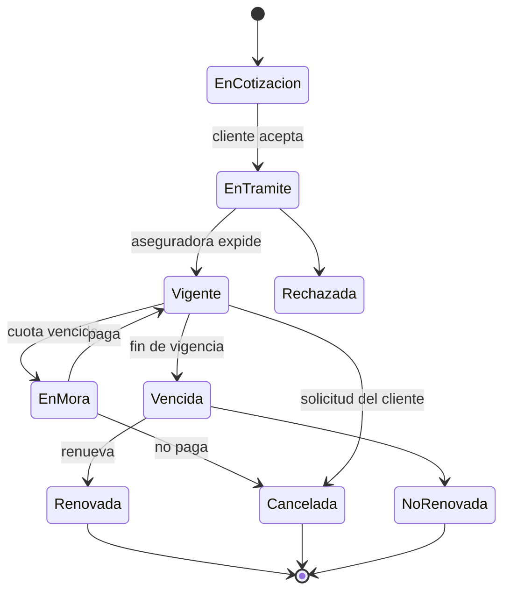

### Estados típicos de un siniestro

`Reportado → Avisado a aseguradora → En documentación → En evaluación → Aprobado / Objetado → Pagado → Cerrado`

---

## 7. Indicadores que suele mirar una agencia

| Indicador | Qué mide |
|---|---|
| Primas emitidas / producción | Volumen de ventas. |
| Tasa de conversión | Cotizaciones que se vuelven pólizas. |
| Tasa de retención / renovación | Clientes que se quedan. |
| Cartera vencida | Primas en mora. |
| Comisiones causadas vs. recibidas | Salud de la conciliación. |
| Tiempo de expedición | Agilidad operativa. |
| Tiempo de atención de siniestros | Calidad del servicio. |
| Pólizas por cliente | Venta cruzada. |
| Siniestralidad de la cartera | Afecta la relación y los incentivos con aseguradoras. |

---

